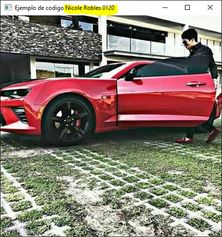
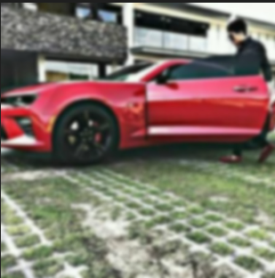
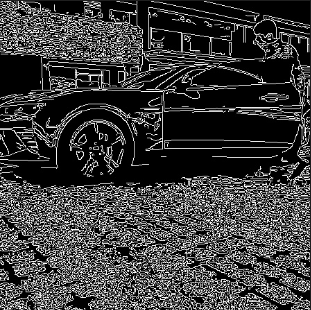
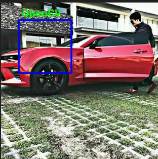
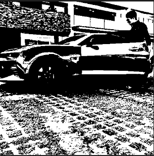
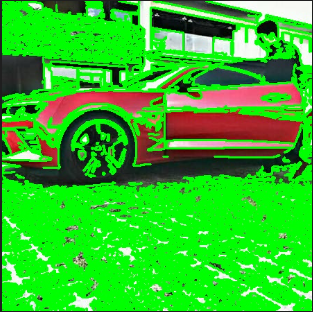

# Estephany Nicole Robles Mendoza NC 0120
## Ejemplo de código:

## Conversión entre espacios de color

## Rotar una imagen

## Desenfoque de una imagen

## Detección de bordes mediante el algoritmo de Canny

## Dibujar formas y añadir texto

## Umbralización

## Detección de contornos

